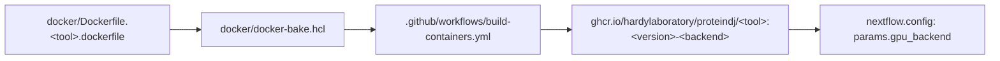

# Container Build Workflow

ProteinDJ's containers are Docker images built by GitHub Actions for two GPU backends (CUDA and
ROCm) and pulled on the cluster with Apptainer. This document describes the setup and how to add
a container.

---

## 1. How the pieces fit together



| File | Role |
|---|---|
| `docker/Dockerfile.<tool>.dockerfile` | One Dockerfile per tool. The `GPU_BACKEND` build arg (`cuda` or `rocm`) selects the base image and GPU packages. |
| `docker/envs/` | Conda environment files for tools that use conda (BindCraft). |
| `docker/smoke/` | GPU-free checks copied into every image at `/opt/smoke`. |
| `docker/docker-bake.hcl` | Single source of truth for tags, build args and the list of tools. |
| `docker/Dockerfile.template.dockerfile` | Scaffold for a new tool. Not built. |
| `.github/scripts/bake_matrix.py` | Reads `docker buildx bake --print` and selects the targets to build. |
| `.github/workflows/build-containers.yml` | Plans the matrix, builds and pushes each target, then smoke-tests it. |

Images are tagged `ghcr.io/hardylaboratory/proteindj/<tool>:<VERSION>-cuda|rocm`. `python_tools`
is CPU-only and has no backend suffix. `VERSION` is a variable in `docker-bake.hcl` and is kept in
sync with `params.container_version` by `scripts/bump_version.py`. The tag is floating: a rebuild
without a version bump overwrites it.

### Version policy

- One ROCm 6.x (`ROCM6_VERSION`, jax 0.4.x wheels, used by `dl_binder_design`) and one ROCm 7.x
  (`ROCM7_VERSION`, everything else) across all images. `rfdiffusion` takes its ROCm release from
  AMD's `rocm/dgl` base image (7.0.0).
- `TORCH_ROCM6_INDEX` and `TORCH_ROCM7_INDEX` must match the ROCm version. Only some torch
  versions are published for each index, so check
  `https://download.pytorch.org/whl/<index>/torch/` before bumping.
- Pin every git clone to a commit and every GPU framework to a version.

---

## 2. Known CUDA/ROCm parity gaps

| Dependency | ROCm status |
|---|---|
| PyTorch | Official wheels from `https://download.pytorch.org/whl/rocm<X.Y>`. |
| JAX | Only the ROCm/jax and ROCm/rocm-jax release wheels (0.4.34 for ROCm 6, 0.6.0 for ROCm 7), so versions differ from CUDA. |
| DGL | Use AMD's `rocm/dgl` image. |
| OpenMM | `openmm[hip6]` / `OpenMM-HIP-7` provide the `HIP` platform. There is no `CUDA` platform. |
| cuEquivariance (Boltz, BoltzGen, RFD4) | NVIDIA only. Boltz needs `--no_kernels` and BoltzGen `--use_kernels false`; the pipeline sets both when `gpu_backend = 'rocm'`. RFD4 is CUDA-only. |

If a tool has no working ROCm path, give it only a `-cuda` target and block the `rocm` backend for
it in the pipeline (see `rfd4_denovo` in `main.nf`).

---

## 3. Adding a new container

1. **Dockerfile.** Copy `docker/Dockerfile.template.dockerfile` to
   `docker/Dockerfile.<tool>.dockerfile` and fill in the placeholders. Keep these rules:
   - Apptainer ignores `ENTRYPOINT`, so put venvs and conda environments on `PATH` with `ENV`.
   - Set `PYTHONNOUSERSITE=1`; Apptainer mounts `$HOME` and user pip installs would shadow the image.
   - Install `procps`; Nextflow needs `ps` in the container.
   - Keep `ENV PROTEINDJ_TOOL=<tool>` and `PROTEINDJ_GPU_BACKEND=${GPU_BACKEND}`.
   - Finish with `COPY smoke/ /opt/smoke/`, plus `RUN python /opt/smoke/check_torch_backend.py` if
     the image uses torch.
2. **Smoke test.** Add a `<tool>)` case to `docker/smoke/smoke_test.sh` with imports and `--help`
   calls that need no GPU.
3. **Bake.** Add the tool name to the `tool` list in the `gpu` target of `docker/docker-bake.hcl`
   and its `-cuda`/`-rocm` names to the `default` group. If it needs the ROCm 6 stack, add it to
   the two `tool == "dl_binder_design"` conditions. CPU-only tools get their own target like
   `python_tools`.
4. **Pipeline.** Add a `withLabel` block to `nextflow.config` using
   `${params.container_registry}/<tool>:${params.container_version}-${params.gpu_backend}` and
   `${params.gpu_backend == 'rocm' ? '--rocm' : '--nv'}`.
5. **Build.** Push to a branch listed in the workflow's `push.branches`, or run the workflow with
   the `targets` input (for example `<tool>-cuda,<tool>-rocm`). The plan job selects only the
   targets whose Dockerfile or `docker/envs/<tool>-*` files changed; edits to `docker-bake.hcl`,
   `docker/smoke/` or the workflow rebuild everything.

No Docker is needed on the cluster, so the workflow is the only build path.

---

## 4. Testing on the cluster

CI runs the smoke test on CPU only. Pull the image and repeat it with a GPU:

```bash
apptainer pull fampnn_v3.1-rocm.sif docker://ghcr.io/hardylaboratory/proteindj/fampnn:v3.1-rocm
apptainer exec --rocm --env SMOKE_GPU=1 fampnn_v3.1-rocm.sif bash /opt/smoke/smoke_test.sh
```

Use `--nv` for CUDA images. `SMOKE_GPU=1` additionally requires torch and jax to see a device.
Packages are private by default; authenticate with
`apptainer remote login --username <user> docker://ghcr.io` or make them public.

Run the pipeline with `--gpu_backend rocm` to select the ROCm images.

### Shared image directory

Nextflow resolves a container first in `apptainer.libraryDir` (read-only), then in
`apptainer.cacheDir`. The file name is the image reference with `/` and `:` replaced by `-` plus
`.img`, for example `ghcr.io-hardylaboratory-proteindj-fampnn-v3.1-rocm.img`. An administrator can
pre-pull each release into the library directory so users never convert images.
